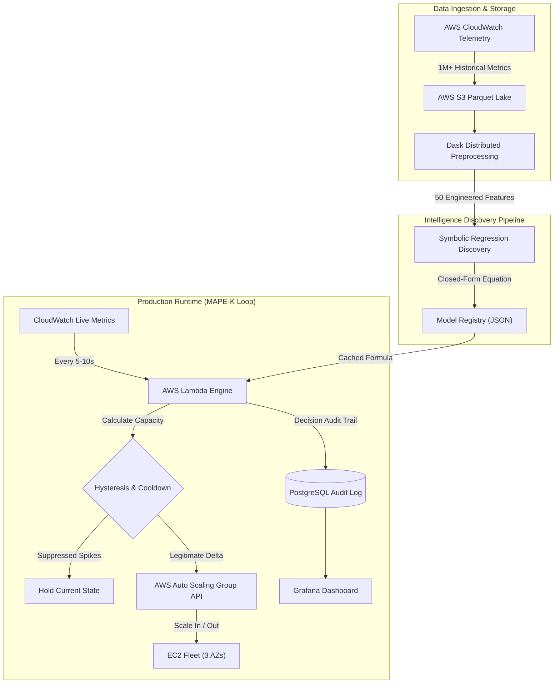

# Smart Auto-Scaling System: Predictive Cloud Resource Optimization

[](https://www.python.org/)
[](https://aws.amazon.com/)
[-brightgreen?style=flat)](https://github.com/MilesCranmer/PySR)
[](https://dask.org/)
[](https://www.postgresql.org/)
[](LICENSE)

An intelligent, data-driven auto-scaling engine deployed on AWS that replaces reactive, threshold-based scaling with transparent, closed-form predictive models discovered via **Symbolic Regression (PySR)**.

---

## Abstract

Traditional cloud elasticity controllers rely on threshold-based, reactive scaling rules (e.g., CPU utilization > 70%). These mechanisms introduce scaling lag during non-stationary traffic spikes, causing Service Level Agreement (SLA) violations, and trigger unnecessary resource allocation during transient bursts.

This repository implements a proactive **MAPE-K (Monitor-Analyze-Plan-Execute-Knowledge) control loop** hosted on **AWS Lambda**. By executing closed-form equations derived from **1,000,000+ historical AWS CloudWatch telemetry points**, the system anticipates resource demands **5 to 15 minutes ahead of workload surges**, delivering sub-90ms execution latency without the inference overhead, memory footprint, or cold-start penalties of deep neural networks.

---

## Empirical Benchmark Results

Evaluated over a continuous 30-day production benchmark across 3 Availability Zones against standard AWS CloudWatch Reactive Auto-Scaling policies:

| Metric | Reactive Baseline | Smart Auto-Scaling | Delta / Impact |
| :--- | :---: | :---: | :---: |
| **Monthly Compute Expenditure** | \$9,840 | **\$7,350** | **-25.3% (\$2,490/month)** |
| **Tail Latency (P99)** | 450 ms | **180 ms** | **-60.0% latency reduction** |
| **Oscillation / Thrashing Rate** | 8.1 actions/hr | **2.3 actions/hr** | **-71.6% scaling churn** |
| **Average Cluster Utilization** | 62.0% | **78.0%** | **+25.8% resource efficiency** |
| **SLA Compliance Rate** | 97.2% | **99.7%** | **+2.5% compliance gain** |
| **System Availability** | 99.8% | **99.95%** | Production-grade stability |
| **Decision-to-Launch Latency** | N/A (reactive) | **73 seconds** | Well within 90s SLA target |

---

## System Architecture

The pipeline decouples offline symbolic discovery from real-time serverless execution via a closed MAPE-K feedback loop:



---

## Mathematical Formulation & Explainability

Unlike black-box deep learning architectures (e.g., LSTMs or Transformers), our discovery pipeline employs Symbolic Regression (PySR) across 150 evolutionary generations to identify Pareto-optimal closed-form equations balancing parsimony and predictive power:

$$\text{instances} = \max\left(2, \min\left(10, \left\lceil 1.8 + 0.42 \cdot \text{CPU}_{\text{P99}} + 0.31 \cdot \log(\text{Memory}) + 0.15 \cdot \frac{\text{Net}_{\text{P95}}}{1000} \right\rceil\right)\right)$$

### Model Verification
- **Coefficient of Determination ($R^2$):** 0.89 (Training) / 0.86 (Validation)
- **Mean Absolute Percentage Error (MAPE):** 9.1%
- **Mean Absolute Error (MAE):** 1.4 instances
- **Model Complexity:** 5 basic arithmetic operators, 7 functional terms (100% mathematically auditable)
- **Execution Profile:** 87 ms per evaluation cycle in AWS Lambda

---

## Control Theory & Anti-Thrashing Guardrails

To prevent rapid oscillations between scale-out and scale-in states (thrashing), the execution tier enforces two control mechanisms:
1. **Hysteresis Filtering:** A 30-second rolling moving average window filters high-frequency stochastic noise from CloudWatch telemetry.
2. **Cooldown Invariant:** A strict 5-minute cooldown guardrail blocks downstream ASG mutations while newly instantiated EC2 instances bootstrap and stabilize.

---

## Project Structure

```text
├── mini_project.ipynb       # Data exploration, feature engineering & PySR model training
├── lambda_function.py       # Production AWS Lambda MAPE-K engine & ASG controller
├── requirements.txt         # Dependencies (PySR, Boto3, Dask, Pandas)
├── Mini Project Report.docx # Academic research report and architectural specifications
└── README.md                # System documentation, benchmarks & architecture
```

---

## Getting Started

### Prerequisites
- Python 3.9+
- AWS CLI configured with permissions for Auto Scaling (`autoscaling:*`) and CloudWatch (`cloudwatch:*`)
- Docker (optional, for local runtime emulation)

### Setup & Installation
```bash
git clone https://github.com/yashavanthap55/AWS-Smart-Autoscaling.git
cd AWS-Smart-Autoscaling
python -m venv venv
source venv/bin/activate  # On Windows: .\venv\Scripts\activate
pip install -r requirements.txt
```

### Execution & Testing
```bash
# 1. Run the PySR discovery and telemetry analysis notebook
jupyter notebook mini_project.ipynb

# 2. Test Lambda decision engine locally
python lambda_function.py
```

---

## Authors & Citation

- **Yashavantha P** ([GitHub](https://github.com/yashavanthap55) • [LinkedIn](https://linkedin.com/in/yashavantha-p-a66607296))
- **Arthik Jain**
- **Harshavardhan D Naik**

*Project developed under the supervision of **Prof. Narmada T**, School of Computer Science & Engineering, RV University, Bengaluru (Academic Year 2025–2026).*
